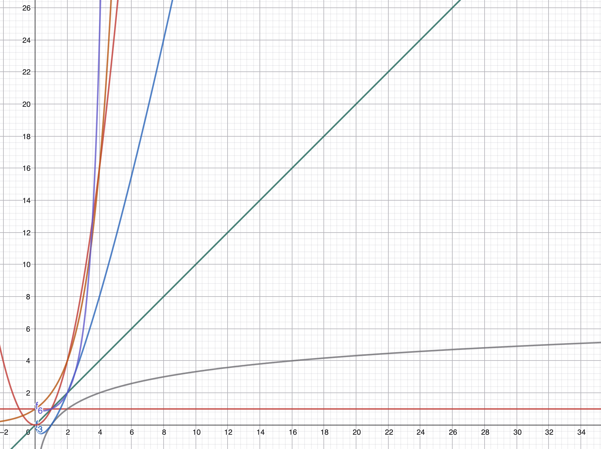

| Fórmula | Time Complexity | Complexity Classes |
| - | - | - |
| O(1)          | Constante          | Polinomial |
| O(log(n))     | Logarítmica        | Polinomial |
| O(n)          | Lineal             | Polinomial |
| O(n * log(n)) | Lineal-logarítmica | Polinomial |
| O(n^2)        | Cuadrática         | Polinomial |
| O(2^n)        | Exponencial        | Super-polynomial |
| O(n!)         | Factorial          | Super-polynomial |

